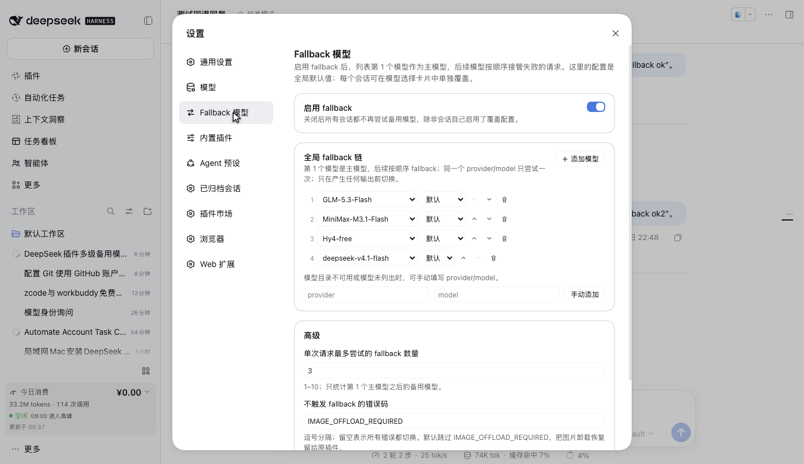
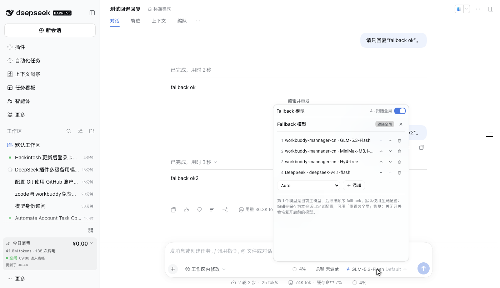

# dsh-fallback-models

English | [中文](README.zh.md)

A [DeepSeek Harness](https://github.com/deepseek-ai/deepseek-harness) plugin that gives model requests a **fallback chain**: when the selected model fails before producing output, the same request is tried on the next configured provider/model route instead of surfacing the failure.

The plugin has two surfaces over one live configuration:

- **Settings → Fallback models** — the global default chain, its switch, the retry budget, and the failure codes that must not fail over.
- **The model menu itself** — a `Fallback models` switch row is added above the shipped model/effort card. Off shows the shipped model page; on covers it with the Session fallback editor. The model selector stays the single entry point.

No build step. The Host half is plain ESM; the browser half is one hand-written `client.js` that imports only React and styles itself with host theme tokens.

## Features

- Multiple fallback models, tried in order. When fallback is on, the **first entry is the primary model**; later entries take over a failed request.
- Global defaults plus a per-Session override: the session follows the global configuration until an edit makes it custom, and a reset button restores it. Turning fallback off restores the model selected before it was enabled.
- A dedicated settings page (not only a raw config form).
- A composer entry next to the model selector, for the current Session.
- Safe failover: only before any content reaches the conversation; never on cancellation; configurable error-code exceptions.
- Live updates: a settings-page or composer edit applies to the next model request without a reload.
- Zero UI dependencies beyond React; no `src/`, no bundler, no `pnpm run build`.

## How it works

```
Agent loop ──► llm/stream waterfall ──► primary adapter
                       │
                       ├── terminal error before content? ──► prepare next route
                       │                                      (prepareCall + own adapter)
                       └── content already streamed? ──► pass the failure through
```

The failover engine is an `llm/stream` listener registered with `prepend: true`. It reads the live Config on every request, builds `primary + fallbacks` (deduplicated by provider/model), and tries at most `maxFallbacks` backup routes.

Two details make it safe:

- **Leading `block-start` chunks are held.** If the provider opens a block and then fails before any delta, the held chunks are dropped and the fallback starts a clean stream. Once a content or usage chunk is exposed, the failure is passed through instead of replaying a partial answer.
- **Each fallback is prepared under its own adapter registration.** `prepareCall()` resolves the route's model metadata and adapter defaults; the dispatch options are copied from the prepared config so `callConfigEquals` holds. A route that rejects the primary's reasoning level or output cap is retried once without those optional constraints.

Why the LLM boundary instead of `agent/request-error`: the Agent loop fixes one `ModelSelection` per step (`step()` passes `decision.selection` to every retry), so changing `agent.model.select()` inside a request-error listener cannot change the model of the retry it asks for. `llm/stream` is the documented routing seam and runs after the loop has logged the request.

## Screenshots

> Captured from the DeepSeek Harness Web GUI; these show the v1.0.0 global settings page and the Session fallback page inside the model selection card.

### Global settings page



Maintain the global default chain, its switch, the fallback budget, and skipped failure codes in **Settings → Fallback models**.

### Model selection card



The model selector is the single entry point: the switch at the top of the card chooses between the shipped model page and the fallback page. When enabled, the first model in the list is the primary and later models take over a failed request in order; the circular-arrow button resets the Session to the global configuration.

## Installation

Requirements: DeepSeek Harness `0.2.2-rc.1` or a compatible `0.2.x`, Node.js `>= 24.9`, and the profile launcher (`dsh web` / the desktop app).

### Option A — folder link (development)

```bash
cd /path/to/dsh-fallback-models
npm install          # resolves @deepseek-ai/schemastery into ./node_modules
```

Then, through the DSH plugin manager:

```jsonc
plugin_manager { "action": "install_bundle", "target": "/absolute/path/to/dsh-fallback-models" }
```

A linked install keeps the folder as the plugin body, so editing `client.js` or the Host files can be picked up by HMR / a page refresh. **Uninstall before deleting or moving the folder.**

### Option B — npm registry (for any DSH profile)

The package is published on npm, so the DSH plugin CLI can install it directly:

```bash
dsh plugin --profile web add dsh-fallback-models
```

The CLI installs the package into that profile and activates it as a bundle layer. Restart `dsh web` / the desktop app if the running Host has not picked up the new profile composition.

### Option C — tarball (standalone copy)

```bash
npm pack
# produces dsh-fallback-models-1.0.0.tgz
```

```jsonc
plugin_manager { "action": "install_bundle", "target": "/absolute/path/to/dsh-fallback-models-1.0.0.tgz" }
```

A tarball install extracts a copy into the profile; the source folder can then be moved or deleted. Upgrade with a new version and another `install_bundle`.

### Verify

- Host row and schema: `cordis_inspect_query` → `host` / `Config` / `listConfigs`, `{ "name": "dsh-fallback-models" }`.
- Browser slots: `cordis_inspect_query` → `client` / `Slots` / `listSubTree`, roots `settings.section` and `conversation.input.model.label`; both should list an active `fallback-models` occupant.
- UI: open **Settings → Fallback models**, and open a Session's model menu; the `Fallback models` switch row sits above the model list, with a reset button when the session carries its own configuration.

## Configuration

The Host row is the settings namespace and stores both layers:

```yaml
- id: fallback-models
  name: dsh-fallback-models
  config:
    enabled: true
    fallbacks:
      - provider: deepseek-official
        model: deepseek-v4.1-flash
      - provider: workbuddy-mannager-cn
        model: auto
    maxFallbacks: 3
    skipCodes: [IMAGE_OFFLOAD_REQUIRED]
    sessions:
      session-abc:
        enabled: true
        fallbacks:
          - provider: workbuddy-mannager-cn
            model: glm-5.3-flash
```

| Field | Meaning |
|---|---|
| `enabled` | Global switch. A Session override carries its own switch. |
| `fallbacks` | Ordered global model list: `{ provider, model, reasoningEffort? }`. The first entry is the primary when fallback is enabled; the rest are fallbacks. |
| `maxFallbacks` | Maximum backup routes attempted for one request (1–10). |
| `skipCodes` | Failure codes that never fail over. Empty means every error fails over. Default: `IMAGE_OFFLOAD_REQUIRED`, so the image-offload recovery keeps ownership. |
| `sessions` | Per-Session overrides keyed by Session id. An absent key follows the global chain. |

### The first entry is the primary

When a Session has fallback enabled and a non-empty list, the plugin treats the **first entry as the active model**:

1. Enabling the switch, adding the first model, reordering the list, or rendering the composer after a reload selects that first route through the shipped `session.selectModel` Remote. The outer model name follows, and the Agent loop's next request uses that route as its normal primary request. An existing session whose selection predates the chain therefore self-heals on the next page load.
2. The remaining entries are fallbacks, tried in order after the primary fails before output.
3. Turning the switch off restores the model that was selected before fallback was enabled (`base` in the Session override). **Reset to global** removes the override; a globally enabled chain then selects the global first entry, while a disabled global chain restores `base`.

If the route cannot be selected (unavailable model, writer conflict), the selection is left unchanged; the chain stays configured and the first entry remains a fallback after the currently selected model. The fallback editor still shows the configured order.

### Session override semantics

- An absent `sessions.<id>` means **follow global**, live: the effective chain is the global one, resolved at request time.
- Any edit (switch, add, remove, reorder) materializes a Session override from the current global values, then applies the change to it.
- **Reset to global** (the circular-arrow button in the switch row) removes the Session key.
- A Session override replaces the global list; it never appends to it. `maxFallbacks` and `skipCodes` remain global policy.

Per-Session overrides live in the profile patch, so they are shared by every browser on the same Host and survive restarts. They are not written into the Session log; deleting the profile or clearing `sessions` removes them.

## Behavior and limitations

- **Only a failure before output fails over.** A provider error after content has streamed is surfaced, because replaying the request would duplicate an answer the user already saw.
- **Cancellation is never failed over.** An `aborted` finish and an aborted request signal end the chain immediately.
- **The logged source is the selected route.** The Agent loop logs `assistant/message.source` as the route it assembled. With fallback on, the plugin selects the chain's first entry as the session model, so the logged source normally matches the active primary. A later fallback is recorded in the adapter's `replayState.response` (for adapters that report provider/model there) and in the Host warning log; the transcript's model label is not rewritten per attempt. If the alignment Remote fails, the old selection remains the logged primary while the configured first entry is a fallback.
- **Provider retries happen first for the primary.** Because the fallback happens inside `llm/stream`, the primary's `llm-retry` policy does not see a failure that a fallback absorbed. If every fallback fails, the last failure reaches `agent/request-error` and the retry policy applies to the primary route.
- **Catalog membership is advisory.** A configured route is attempted even if the catalog no longer lists it; an unavailable adapter or model is skipped, and the next route is tried.
- **Hand-built calls without a `sessionId` are untouched.** The engine only reads a chain for a Session-bound request; auxiliary one-shot callers that pass no Session id keep their existing behavior.
- **Session config accumulation.** Per-Session entries are kept until cleared. Use the switch row's reset button to remove one; a profile whose sessions change often may want a periodic cleanup of the `sessions` map.
- **No client-visible fallback toast in 1.0.** A client-facing notice needs a generated Remote or a Session projection; adding one is listed in `docs/design.md` as future work.

## Development

```bash
npm install
npm test
```

The suite uses Node's built-in test runner:

- `test/fallback-stream.test.js` — config normalization, route deduplication, hold/commit behavior, fallback selection, budget, skip codes, aborted streams, unavailable routes, and optional-constraint retry.
- `test/client-smoke.test.js` — loads `client.js` through a fake `window.__ModuleLoader__` and asserts the registrations, the locale dictionaries, and the injected form/catalog faces.

Layout:

| Path | Role |
|---|---|
| `index.js` | Host entry: `name`, `inject`, `Config`, `apply` (installs the listener and suppresses the generic form). |
| `lib/config.js` | Schemastery Config, normalization, global/Session resolution. |
| `lib/fallback-stream.js` | The `llm/stream` engine, prepared dispatch, streaming hold. |
| `client.js` | Settings page, navigation icon, model label, model-menu switch card, styles. |
| `cordis.patch.yml` | The single Host row inserted into the profile composition. |
| `locale/*.json` | Plugin-manager title and description. |
| `docs/design.md` | Design decisions, API references, and deferred work. |

## License

MIT. See [LICENSE](LICENSE).
