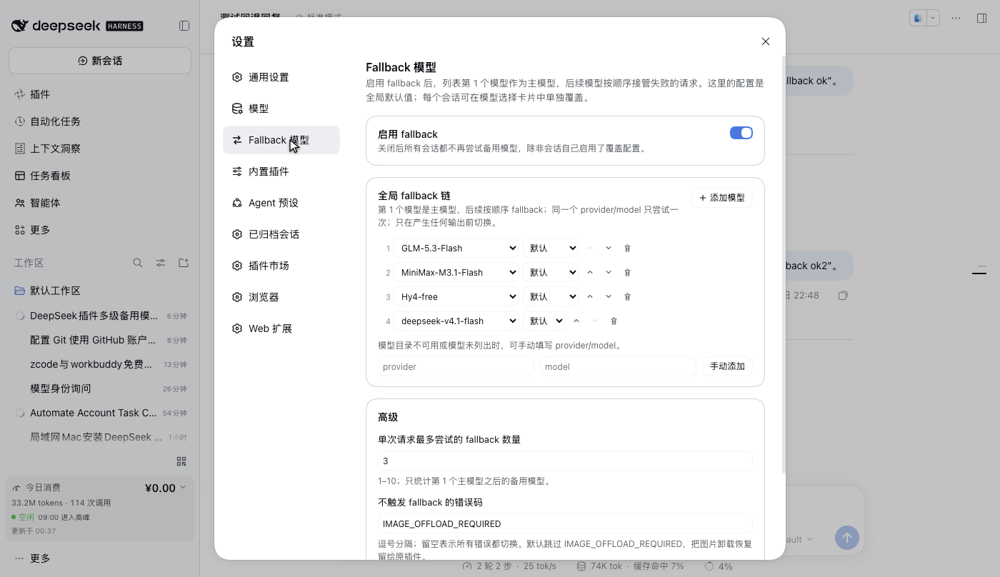
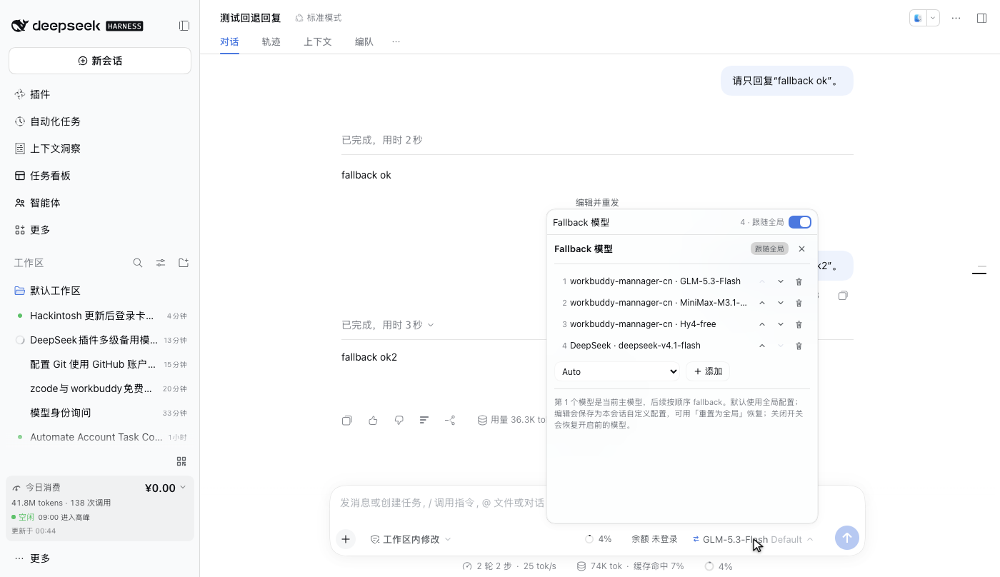

# dsh-fallback-models

[English](README.md) | 中文

一个 [DeepSeek Harness](https://github.com/deepseek-ai/deepseek-harness) 插件，为模型请求增加 **fallback 链**：当所选模型在产生任何输出之前失败时，同一个请求会按顺序改由下一个 provider/model 路由处理，而不是把错误直接抛给对话。

插件用同一份实时配置驱动两个界面：

- **设置 → Fallback 模型**：全局默认链、总开关、单次请求的备用数量上限、不触发回退的错误码。
- **模型选择卡片本身**：在官方“模型/推理等级”卡片上方加一行 `Fallback 模型` 开关。关闭时显示官方模型页；打开时用会话 fallback 编辑页覆盖。模型选择仍是唯一入口。

零构建：Host 半是原生 ESM；浏览器半是单个手写 `client.js`，只依赖 React，样式全部使用宿主主题 token。

## 功能

- 多个 fallback 模型，按列表顺序尝试；启用后**列表第 1 个就是主模型**，后续模型接管失败请求。
- 全局默认 + 会话级覆盖：会话默认沿用全局配置，编辑后成为本会话自定义配置，可用重置按钮恢复全局。关闭 fallback 会恢复开启前选中的模型。
- 插件独立设置页面，而不是只暴露一份原始配置。
- 会话页在模型选择位置旁边提供入口。
- 安全回退：只在内容产生前切换；取消请求不回退；错误码可排除。
- 实时生效：设置页或会话菜单的修改对下一次模型请求立即生效，无需刷新。
- 除 React 外零 UI 依赖；无 `src/`、无打包器、无 `pnpm run build`。

## 工作原理

```
Agent loop ──► llm/stream 瀑布 ──► 主模型 adapter
                    │
                    ├── 内容产生前的 terminal error？ ──► prepareCall 下一个路由
                    │
                    └── 已经产生内容？ ──► 原样抛出失败
```

failover 引擎是注册在 `llm/stream` 瀑布上的监听器（`prepend: true`）。它在每个请求上读取实时 Config，构造 `主模型 + fallbacks`（按 provider/model 去重），最多尝试 `maxFallbacks` 个备用路由。

两个关键安全点：

- **先扣住开头的 `block-start`。** 如果 provider 开了块、但在任何 delta 之前失败，扣住的块会被丢弃，fallback 从干净的流开始；一旦内容或 usage 块已经暴露，失败就原样传递，不会重放半截回答。
- **每个 fallback 都在自己的 adapter 注册下准备。** `prepareCall()` 解析该路由的模型元数据和 adapter 默认值；派发参数从 prepared config 复制，保证 `callConfigEquals` 成立。如果该路由不接受主模型的推理等级或输出上限，会去掉这两个可选约束再准备一次。

为什么挂在 LLM 边界而不是 `agent/request-error`：Agent loop 在一个 step 内固定 `ModelSelection`（`step()` 把 `decision.selection` 传给每一次重试），所以在 request-error 监听器里调用 `agent.model.select()` 无法改变它请求的那次重试所用的模型。`llm/stream` 是官方文档标注的路由缝隙（retry、replay、routing），且在 loop 记录请求之后运行。

## 界面预览

> 截图来自 DeepSeek Harness Web GUI。图片展示的是 v1.0.0 的全局配置页与模型选择卡片里的会话 fallback 页面。

### 全局配置页



在「设置 → Fallback 模型」中维护全局默认链、开关、回退数量上限和跳过的错误码。

### 模型选择卡片



模型选择是唯一入口：卡片顶部的开关决定显示官方模型页还是 fallback 页面。开启后，列表第 1 个模型成为主模型，后续模型按顺序接管失败请求；右侧回转按钮把会话配置重置为全局配置。

## 安装

要求：DeepSeek Harness `0.2.2-rc.1` 或兼容的 `0.2.x`、Node.js `>= 24.9`、profile 启动器（`dsh web` / 桌面端）。

### 方式 A —— 文件夹链接（开发）

```bash
cd /path/to/dsh-fallback-models
npm install          # 把 @deepseek-ai/schemastery 装进 ./node_modules
```

然后通过 DSH 插件管理器：

```jsonc
plugin_manager { "action": "install_bundle", "target": "/absolute/path/to/dsh-fallback-models" }
```

链接安装时本体始终是这个文件夹，改 `client.js` 或 Host 文件后可被 HMR / 页面刷新拾取。**删除或移动文件夹前必须先卸载。**

### 方式 B —— npm 包（任意 profile）

包已发布到 npm，可直接用 DSH 插件 CLI 安装：

```bash
dsh plugin --profile web add dsh-fallback-models
```

CLI 会把包安装到该 profile、写入 `dsh.profile.bundles` 并激活 bundle layer（1.0.0 已在干净 profile 实测）。若当前 Host 还没重新读取 profile 组合，重启 `dsh web` / 桌面端即可。卸载：`dsh plugin --profile web remove dsh-fallback-models`。

### 方式 C —— tarball（独立副本）

```bash
npm pack
# 生成 dsh-fallback-models-1.0.0.tgz
```

```jsonc
plugin_manager { "action": "install_bundle", "target": "/absolute/path/to/dsh-fallback-models-1.0.0.tgz" }
```

tarball 安装会在 profile 里解压一份独立副本，源文件夹之后可以移动或删除。升级时改版本号、重新 `npm pack`、再 `install_bundle`。

### 验证

- Host 行与 schema：`cordis_inspect_query` → `host` / `Config` / `listConfigs`，`{ "name": "dsh-fallback-models" }`。
- 浏览器槽位：`cordis_inspect_query` → `client` / `Slots` / `listSubTree`，根为 `settings.section` 和 `conversation.input.model.label`，两处都应出现 active 的 `fallback-models`。
- 界面：打开 **设置 → Fallback 模型**；进入任意会话点开模型选择，`Fallback 模型` 开关行应出现在模型列表上方，会话有自定义配置时旁边还有重置按钮。

## 配置

Host 行同时是设置命名空间，两层配置都在这里：

```yaml
- id: fallback-models
  name: dsh-fallback-models
  config:
    enabled: true
    fallbacks:
      - provider: deepseek-official
        model: deepseek-v4.1-flash
      - provider: workbuddy-mannager-cn
        model: auto
    maxFallbacks: 3
    skipCodes: [IMAGE_OFFLOAD_REQUIRED]
    sessions:
      session-abc:
        enabled: true
        fallbacks:
          - provider: workbuddy-mannager-cn
            model: glm-5.3-flash
```

| 字段 | 含义 |
|---|---|
| `enabled` | 全局开关；会话覆盖自带开关。 |
| `fallbacks` | 有序全局模型列表：`{ provider, model, reasoningEffort? }`；启用后第 1 个是主模型，其余是 fallback。 |
| `maxFallbacks` | 单次请求最多尝试的备用路由数（1–10）。 |
| `skipCodes` | 永不触发回退的错误码；留空表示所有错误都切换。默认 `IMAGE_OFFLOAD_REQUIRED`，把图片卸载恢复留给原插件。 |
| `sessions` | 按会话 id 存放的覆盖；键不存在表示跟随全局。 |

### 第 1 个模型就是主模型

当会话启用 fallback 且列表非空时，插件把**第 1 个条目当作当前主模型**：

1. 打开开关、添加第一个模型、调整顺序，或刷新后重新渲染作曲器时，插件通过官方 `session.selectModel` Remote 选中第 1 个路由。最外层的模型名称跟随，Agent loop 的下一次请求就把它当作正常主请求。因此旧会话即使选择早于链配置，也会在下次刷新时自动对齐。
2. 其余条目是 fallback，按顺序在主模型产生输出前失败时接管。
3. 关闭开关会恢复开启 fallback 之前选中的模型（会话覆盖里的 `base`）。**重置为全局**会删除覆盖；全局链启用时选全局第 1 个，全局关闭时恢复 `base`。

如果该路由无法被选中（模型不可用、会话写入冲突），选择保持不变；链仍保留，第 1 个条目会作为当前所选模型之后的 fallback。编辑页仍显示配置的顺序。

### 会话覆盖语义

- `sessions.<id>` 不存在 = **实时跟随全局**：生效链在每次请求时从全局解析。
- 任何编辑（开关、添加、删除、排序）会把当前全局值物化成本会话覆盖，再在该覆盖上应用改动。
- **重置为全局**（开关行右侧的回转箭头按钮）：删除该会话的键。
- 会话覆盖整体替换全局链，不会追加；`maxFallbacks` 和 `skipCodes` 始终是全局策略。

会话覆盖存放在 profile patch 中，同一 Host 的所有浏览器共享，重启后保留；它不写入会话日志。清除 `sessions` 或删除 profile 即可移除。

## 行为与边界

- **只在产生输出前回退。** 如果 provider 在已经流出内容后失败，错误会原样暴露；重放请求会重复用户已经看到的回答。
- **取消永不回退。** `aborted` finish 或已 abort 的请求信号会立即结束链。
- **日志里的来源是所选路由。** Agent loop 把 `assistant/message.source` 记录为它组装的所选路由。启用 fallback 时插件会把链的第 1 个条目选为会话模型，所以日志来源通常与当前主模型一致；后续 fallback 记录在 adapter 的 `replayState.response`（前提是该 adapter 上报 provider/model）和 Host 警告日志里，对话中的模型标签不会按每次尝试改写。如果对齐用的 Remote 失败，旧选择仍是日志主模型，而配置的第 1 个条目会退化为 fallback。
- **主模型的 provider 重试优先。** 由于回退发生在 `llm/stream` 内部，被 fallback 吸收的失败不会进入主模型的 `llm-retry` 策略；如果所有 fallback 都失败，最后一个失败才会到达 `agent/request-error`，由重试策略处理主路由。
- **模型目录只是建议。** 即使目录不再列出某个已配置路由，它仍会被尝试；adapter/model 不可用时跳过并继续下一个。
- **没有 `sessionId` 的手工调用不受影响。** 引擎只为绑定会话的请求读取链；不传 Session id 的一次性调用保持原行为。
- **会话配置会累积。** 每个会话条目会保留到被清除；用开关行的重置按钮移除单个条目，或定期清理 `sessions`。
- **1.0 没有客户端回退提示。** 客户端可见的提示需要生成式 Remote 或 Session projection，已列在 `docs/design.md` 的后续工作里。

## 开发

```bash
npm install
npm test
```

测试使用 Node 内置 test runner：

- `test/fallback-stream.test.js` —— 配置归一化、路由去重、扣留/提交行为、fallback 选择、数量上限、跳过错误码、abort、不可用路由、可选约束重试。
- `test/client-smoke.test.js` —— 通过伪 `window.__ModuleLoader__` 加载 `client.js`，断言两个槽位注册、locale 字典、注入的 form/catalog。

文件结构：

| 路径 | 作用 |
|---|---|
| `index.js` | Host 入口：`name`、`inject`、`Config`、`apply`（安装监听器并关闭通用表单）。 |
| `lib/config.js` | Schemastery Config、归一化、全局/会话解析。 |
| `lib/fallback-stream.js` | `llm/stream` 引擎、prepared 派发、流扣留。 |
| `client.js` | 设置页、导航图标、模型标签、模型选择开关卡片、样式。 |
| `cordis.patch.yml` | 插入 profile 组合的单个 Host 行。 |
| `locale/*.json` | 插件管理器里的标题与描述。 |
| `docs/design.md` | 设计决策、API 引用、后续工作。 |

## 许可证

MIT，见 [LICENSE](LICENSE)。
